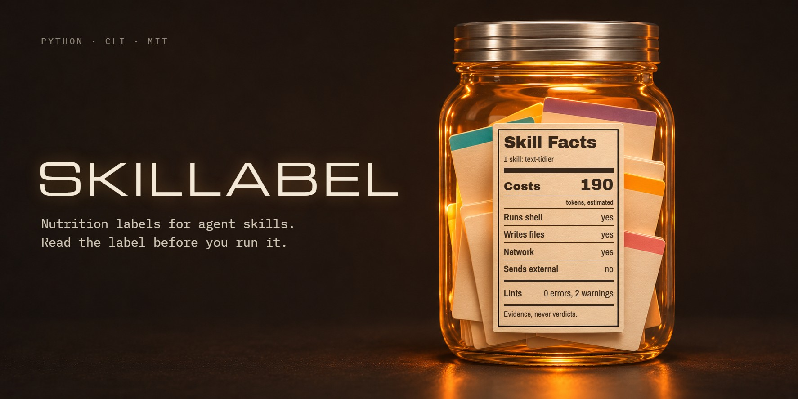
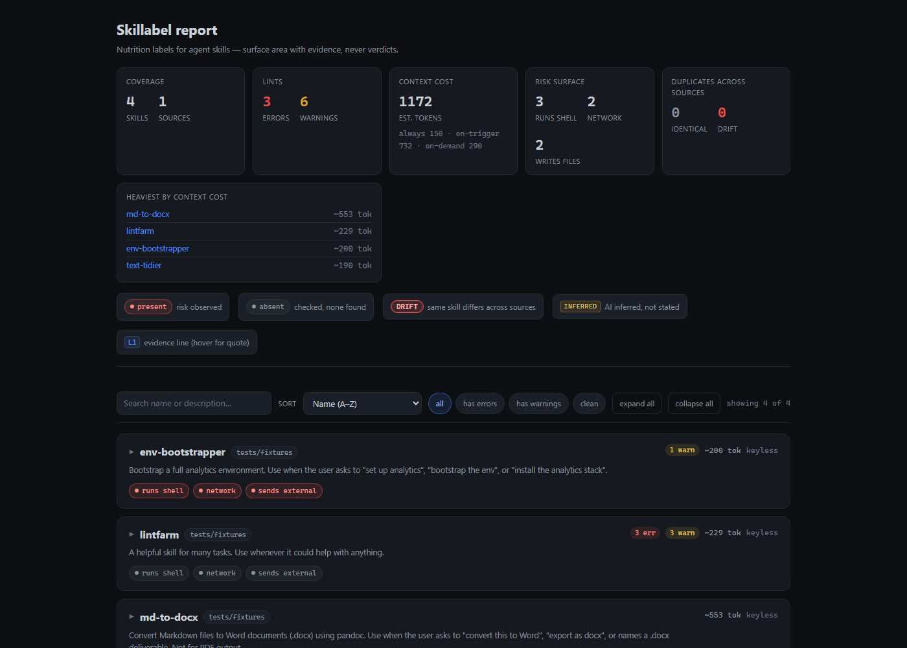

<p align="center"></p>

# Skillabel

> **Nutrition labels for agent skills** — what a skill needs, what it touches,
> and what it costs in context, *before* you install it.



Everyone shares and installs agent skills; nobody can actually read them. A
skill is a contract hidden in prose written for a model: when it fires, what it
needs, what it will do, what it produces, what it touches, and what it costs.
Skillabel extracts that contract from a `SKILL.md` and renders it as a fixed
**label**, adds an evidence-cited **report card**, and ships as a CLI, a
single-file HTML report, and a GitHub Action that posts the label on every PR.
It makes a team skills repo reviewable.

## Who it's for

Skillabel is for people who install agent skills they did not write, and for teams that review each other's skills in a shared repo. It works on any folder with a `SKILL.md` in it, whichever agent the skill was written for. It isn't a scanner that tells you a skill is safe, and it isn't a sandbox: it shows what a skill says it will touch, with the line it says it on, and the judgment stays yours.

## Install

Skillabel is not on PyPI yet, so you install it from this repository, once,
into its own virtual environment. You need git and Python 3.12 or newer.

With [uv](https://docs.astral.sh/uv/) 0.9 or newer, at the exact versions in
`uv.lock`:

```bash
git clone https://github.com/yavuz-ozkan/skillabel
cd skillabel
uv sync --frozen
source .venv/bin/activate        # Windows PowerShell: .venv\Scripts\Activate.ps1
```

Or with pip, also at the exact locked versions, each checked against its hash
(a plain `pip install .` would instead take the newest versions its ranges
allow):

```bash
git clone https://github.com/yavuz-ozkan/skillabel
cd skillabel
python -m venv .venv
source .venv/bin/activate        # Windows PowerShell: .venv\Scripts\Activate.ps1
pip install --require-hashes --only-binary :all: -r action-requirements.txt -r action-build-requirements.txt
pip install --no-deps --no-build-isolation .
```

With the environment active, the `skillabel` command works from any folder:

```bash
skillabel scan tests/fixtures
skillabel report tests/fixtures
```

These label the four sample skills that ship with the repo and write
`~/skillabel-reports/skillabel-report.html`. Open that file in a browser to see
the report shown above.

### Run it safely on a folder you are checking

Skillabel is made to be run on skills written by other people. Run the
installed `skillabel` command on them, and nothing else:

- Never run `uv run`, `uv sync`, `pip install .` or `python -m ...` inside a
  folder you are checking. Those commands can run that folder's own build code
  or import its files.
- `--ai` sends each skill's text to an AI provider. The provider and key come
  only from your own environment (see [Provider config](#provider-config)).
  Skillabel never reads a `.env` file, so a `.env` in the folder you check
  cannot choose where your skills go.
- Skillabel never follows a link or junction inside the folder it scans: a
  linked file is not read and is listed as a `linked-file` finding (a linked
  `SKILL.md` is an error, and that skill is shown as not checked). A skill
  folder that is itself a link or junction below the folder you name is not
  entered: it gets a label of its own that says "not checked: a link or
  junction, not followed" (a `linked-skill-folder` warning), in the label
  files, the report and the PR comment, and it is named on stderr ("Skipped a
  link or junction"). Such a folder may not be a skill at all; skillabel does
  not look. To label it, name it on the command line. The folder you name may
  be a link. One exception: `auto` follows a link that sits directly inside
  one of your own home skill folders (`~/.claude/skills`, `~/.agents/skills`,
  `~/.codex/skills`) and points to a folder with a `SKILL.md`, because you put
  it there. Nothing below that folder is followed, and a link to a skill that
  is already labelled is not labelled twice. A link to a folder of several
  skills (with no `SKILL.md` of its own) is still skipped. Following a link
  reads that whole folder, up to the caps, and with `--ai` sends it. It never writes
  through a link either: a write that would go through one is refused.
- Labels written by an older version were made from `SKILL.md` alone. Scan
  again before you read a report: the "no pattern matched" wording covers
  bundled files only for labels made by this version.
- On Windows, run skillabel from outside the folder you check, or by its full
  path: `cmd.exe` runs a program found in the current folder before one on your
  PATH.
- `report` shows whatever label files are in the folder. Run it after your own
  `scan`, which clears the folder first.
- Label files and reports hold local file paths, which include your user name.
  Look before you share one.

## Skills living outside the standard locations?

`skillabel auto` probes the standard installs (`~/.claude/skills`, `~/.agents/skills`,
`~/.codex/skills`, plugin dirs, the current project). For collections that are
checkouts rather than installs — a team skills repo, a project's `.claude/skills` —
list them once in `~/.skillabel.toml` and `auto` stays a zero-argument command:

```toml
[discovery]
extra_roots = [
  "C:/dev/git/team-skills",
  "C:/dev/git/my-app/.claude/skills",
]
```

## Do I even use this skill?

You installed 147 skills. Which ones do you actually *use*? Skillabel answers
that **retroactively, with zero setup** — no telemetry, no wrapper, no opt-in
flag you forgot to set six months ago. It reads the session logs your agents
*already* keep on disk and counts real skill invocations:

- **Claude Code** — `~/.claude/projects/**/*.jsonl`: every `Skill` tool call, plus
  slash-command markers (`/tdd`) that resolve to a skill you have installed.
  Harness built-ins like `/clear` or `/rate-limit-options` never count.
- **Codex** — `~/.codex/sessions/**/*.jsonl`: a use is counted once per session
  per skill whose `SKILL.md` the agent actually **opened** (a `shell_command`
  reading `.../skills/<slug>/SKILL.md`). The skills *catalog* that every session
  prompt lists is deliberately ignored — that's availability, not usage.

`skillabel auto` (and `report`) overlay this on the report by default when the
logs exist (`--no-usage` to skip): each card gets a usage line —
*"34 uses · last used 2d ago · claude 30 / codex 4"* or a muted **never used** —
plus a most-used dashboard tile, a **never-used count** (the decluttering
signal), a sort-by-usage control, and a *never used* filter chip. Usage is
written to a machine-local sidecar, `~/skillabel-reports/usage.json`, never
into the scanned folder or the shareable label files. The HTML report itself
does carry the usage lines when usage is on; use `--no-usage` for a report you
plan to share.

**Privacy:** everything stays on your machine — nothing is uploaded, and only
**skill names and timestamps** are ever read from the logs. Prompt and message
content is never parsed, logged, or stored.

## Security stance — a flashlight, not a sandbox

Skillabel reports **surface area with evidence, never verdicts.** A badge says
`runs shell (L18)` and links to the exact line — it never says "safe" or
"unsafe." There is deliberately no safe/unsafe field anywhere in the tool. An
LLM can be misled by the very prose it is auditing: a malicious skill can claim
to be harmless while shelling out and phoning home (see the `wolf` test
fixture — prose swears it's side-effect-free, the body runs `bash` and `curl`;
the deterministic regex pre-pass flags both regardless of what any AI concludes).
Overclaiming safety would destroy exactly the trust the tool exists to provide.
Skillabel shows you the surface area and cites its evidence; **the judgment is
yours.**

The deterministic layer (frontmatter, lints, token costs, regex risk pre-pass)
is fully useful **with no API key at all** — that's what makes the CI gate
trustworthy. The AI layer only ever adds extraction and a report card on top; it
is an enhancement, never the floor.

### Skillabel's own label

The same questions, asked of skillabel itself.

| Panel | Skillabel |
|---|---|
| **Reads** | The skill folders you name. `report` reads the label files in `<path>/.skillabel/`. `auto` also reads the standard skill folders under your home folder and this project's `./.claude/skills`, plugin skill folders under `~/.claude/plugins`, and `~/.skillabel.toml`. `auto` and `report` read skill names and timestamps from the Claude Code and Codex session logs (`~/.claude/projects`, `~/.codex/sessions`) unless you pass `--no-usage`. It never opens, stats or reads a `.env` file; the AI settings come only from the process environment. No link or junction inside a scanned folder is followed, and no file is read past a size cap (see [What "checked" covers](#what-checked-covers)). |
| **Writes** | `scan`: `<path>/.skillabel/*.json` (or under `--out`); it first removes the old `*.json` files in that folder, so only this scan's labels are there. `report`: `~/skillabel-reports/skillabel-report.html` (or `--out`; a report saved inside `<path>` carries no usage numbers), and `~/skillabel-reports/usage.json` when session logs exist. `auto`: `~/skillabel-reports/skills-report.html` (or `--out`) and `usage.json` next to it. A write that would go through a link or junction inside the scanned folder is refused. |
| **Runs** | No shell commands and no subprocesses. `auto` opens the report in your browser (`--no-open` to skip). |
| **Network** | None, unless you pass `--ai`. Then each skill's text goes to Anthropic or OpenRouter, whichever the settings above pick. |
| **GitHub Action** | Installs its dependencies at the exact `uv.lock` versions, checked by hash, from wheels only. Uses `actions/setup-python` and `actions/upload-artifact` pinned to commit SHAs. Writes nothing into the checked-out pull request: labels, the report and the comment go to a fresh folder under `$RUNNER_TEMP`. Runs `git fetch` and `git diff` to find the changed skills, posts or updates its own PR comment with `gh api` and the job's token, and uploads the HTML report as a build artifact. In `mode: full` it sends skill text to the provider whose key you pass, and it runs in the checked-out PR, so set `SKILLABEL_AI_PROVIDER` in `env:` next to the key (see [docs/action.md](docs/action.md)). |

Set your key in your own environment: it is the only place skillabel takes
it from. Versions before this one read `./.env` in the folder you ran them
from; this one does not. Every `--ai` run prints one line naming the
provider.

## Quickstart

Install first: see [Install](#install).

**Don't know where your skills live? Just run:**

```bash
skillabel auto
```

Zero arguments. It finds every place your skills are installed — `~/.claude/skills`,
`~/.agents/skills`, this project's `./.claude/skills`, and plugin-installed skills
under `~/.claude/plugins/**/skills` — labels all of them into **one** self-contained
report at `~/skillabel-reports/skills-report.html`, prints a plain-language summary
(which roots it found, how many skills, total errors/warnings), and opens the report
in your browser. It also flags the same skill installed in two places and tells you
whether the copies are **identical** or have **drifted**. Every skill folder it did not
check because it is a link (in a project or plugin folder, or a skill folder reached
through a link) is named in the report and counted in the summary, with the command
that labels it on purpose: `skillabel scan "<path>" --out "~/skillabel-reports/linked/<name>"`
and then `skillabel report` on that folder. Run it only if you know where the link
points. The command is printed only for a plain path (letters, digits, spaces and
`. _ - / \ :`); for any other path the summary says to label it by hand. The first 15
are listed; the report has them all. Add `--no-open` to skip the
browser, `--out FILE` to redirect, `--ai` to enrich.

Prefer to point it at a specific tree? `scan`/`report`/`lint` still work on any repo
containing one or more `SKILL.md` files:

```bash
skillabel scan   ./skills                 # discover skills -> .skillabel/*.json
skillabel scan   ./skills ~/.claude/skills # scan MULTIPLE roots at once (each label tags its source)
skillabel report ./skills                 # -> ~/skillabel-reports/skillabel-report.html
skillabel lint   ./skills                 # deterministic checks, exit 1 on errors (the CI gate)
```

`scan` and `lint` accept a single skill directory, a whole repo tree, or several
of either. Add `--ai` to `scan` to enrich with extraction and a report card (see
[Keyless vs `--ai`](#keyless-vs---ai)).

### Commands

| Command | What it does |
|---|---|
| `skillabel auto [--ai] [--out FILE] [--no-open]` | Discovers every installed-skill root, scans them all, writes one combined report to `~/skillabel-reports/skills-report.html`, and opens it. Exits 1 (listing the paths checked) if it finds nothing. |
| `skillabel scan <path>... [--ai] [--model M] [--out DIR]` | Discovers skills across one or more roots, builds labels, writes `<out>/.skillabel/<source>__<slug>-<hash>.json`, where `<hash>` is a short hash of the skill's folder path, so two skills with the same name never share a file. `--ai` enriches; a missing key degrades to keyless with one warning. |
| `skillabel report <path> [--out FILE]` | Reads `.skillabel/*.json`, renders one self-contained HTML report (offline-openable), by default `~/skillabel-reports/skillabel-report.html`. It shows whatever label files are in that folder, so run `scan` first. |
| `skillabel lint <path> [--strict]` | Deterministic checks only — never calls AI. Exit 1 on any error; `--strict` also fails on warnings. A folder it could not check (a link or junction, or one named like a `.env` file) is listed as a warning. |

### Multi-source scan & drift detection

Skills get copied around — the same `write-a-skill` can live in `~/.claude/skills`
**and** `~/.agents/skills`, and the two copies quietly diverge. When a report spans
more than one source, every skill card is badged with the source it came from, and any
skill that appears under multiple sources is compared by its `SKILL.md` content hash:

- **`duplicate (identical)`** — the copies are byte-for-byte the same.
- **`DRIFT`** (loud) — the copies differ, with a short summary of *what* differs
  (description, body length, and/or lint results).

The aggregate dashboard at the top of the report totals the duplicate and drift counts
alongside skills, sources, lint errors/warnings, summed context cost, the five heaviest
skills, and the risk-surface distribution (how many skills run shell, hit the network, or
write files). The report is interactive client-side: instant search, sort (name / context
cost / errors / risk), severity filter chips, and — when multiple sources are present — a
per-source filter, all with zero network calls.

## The six panels

Every label renders the same six panels, in this order — so you learn to read a
skill the way you read a nutrition label:

| Panel | Answers | Source |
|---|---|---|
| **Fires when** | When does this skill trigger — and when should it *not*? | trigger contract |
| **Needs** | What inputs, tools, files, env vars, or keys does it require? | inputs |
| **Does** | What are the numbered steps, and which tools does each use? | flow |
| **Produces** | What does it leave behind — files, messages, PRs, side effects? | outputs |
| **Touches** | What is the audit surface: shell, network, secrets, packages? Each with evidence lines. | risk flags |
| **Costs** | Context budget: always-loaded description, on-trigger body, on-demand reference files. | context cost |

Then two more sections: **Lints** (deterministic findings) and the **Report
card** (five graded dimensions). Every extracted fact carries evidence line
chips — `L84`, hover for the quote — and anything the AI *inferred* rather than
found stated is marked with an `inferred` tag. Facts you can't see the evidence
for are facts you shouldn't trust.

## Keyless vs `--ai`

**Keyless (default).** `scan` and `lint` run with zero configuration and no
network. You get: frontmatter parsing, all lints, the three-tier token cost, and
the **regex risk pre-pass** that checks the big three —
`runs_shell`, `network`, `sends_external` — marking each present, or "no
pattern matched". The extraction panels and report card show a *"run with
`--ai`"* note in their place.

### What "checked" covers

The risk pre-pass is a set of text patterns. It reads the text of `SKILL.md`
and of every bundled text file, after turning look-alike letters (such as a
Cyrillic `с` in `сurl`) and styled or zero-width characters into plain ones.
"No pattern matched" means only that: no pattern matched in the text that was
read. A skill can still dodge a pattern, for example by splitting a command
into two strings or encoding it, so this is a flashlight, not a proof.

Some files are not read, and the label lists each one with the reason: a
`.env` file (`.env`, `.env.local` and the like, which skillabel never opens,
stats or reads, wherever it is; an `env-file` info finding names it), a link
or junction, a file over 1 MiB, a file that is not text (such as an image),
files past the first 2000 or deeper than 12 folders, and anything past 8 MiB
for one skill. When the skill's own `SKILL.md` is not read (it is a link, over
1 MiB, or not text), the label says **not checked** and makes no risk claim.

A skill can also keep its real instructions in a file outside its folder, such
as `../../docs/setup.md`, `~/plan.md` or `/etc/x`. Skillabel never reads such
a file. When the skill's text (its frontmatter, such as the description, or its
body), or a bundled text file (`.md`, `.txt`, `.rst`, `.adoc`, `.yaml`, `.yml`,
`.json`, `.toml`, `.html`), points to one, the label gets an `outside-reference` finding that names it and says it
was not read. It is a warning when the path climbs out of the skill folder with
`..` (counted from the file it is written in), or points to another machine
(`\\host\share`, `file:`); it is info for a home, system or absolute path. This
is best effort: a pointer can be written in a way the check does not see, and
scripts (`.py`, `.sh`, `.js` and the like) are not read for pointers, because code
uses `../` paths honestly.

**`--ai`.** Adds structured extraction (Fires when / Needs / Does / Produces,
plus refined risk evidence) and the rubric-graded report card. Every fact still
cites lines; findings whose cited lines don't exist are dropped. A regex risk
flag that fired **survives even if the AI disagrees** — the deterministic layer
is never overwritten.

### Provider config

`--ai` resolves a provider from the process environment, and only from it.
Skillabel never reads a `.env` file (versions before this one read `./.env`;
if you kept your key there, set it in your environment instead):

| Variable | Effect |
|---|---|
| `ANTHROPIC_API_KEY` | Use the Anthropic API directly. |
| `OPENROUTER_API_KEY` | Use OpenRouter's OpenAI-compatible endpoint. |
| `SKILLABEL_AI_PROVIDER` | `auto` (default — Anthropic if its key is set, else OpenRouter), `anthropic`, or `openrouter`. |

No key configured? `--ai` prints a single warning line and continues with the
deterministic label. It never hard-fails for a missing key.

What the AI writes (Fires when, Needs, Does, Produces, the report card) is
marked as an AI summary of the skill's own text. A skill can steer it, so the
tool's own lines (Touches, Costs, Lints) come from the deterministic layer only.

## GitHub Action

Post one sticky label comment on every PR that touches your skills:

```yaml
name: skillabel
on:
  pull_request:
    paths: ["skills/**"]
permissions:
  contents: read
  pull-requests: write
jobs:
  label:
    runs-on: ubuntu-latest
    steps:
      - uses: actions/checkout@v7
        with: { fetch-depth: 0 }
      - uses: yavuz-ozkan/skillabel@v0.3.0
        with:
          path: skills
          mode: lint        # start here — see the rollout note
```

**Rollout note — start with `mode: lint`.** The default `mode: lint` runs
*objective checks only*: no LLM, no judgment grades. It's the socially safe way
to bring the tool to a team's skills repo — nobody's work gets an opinionated
letter grade on day one. Once the team is comfortable, switch to `mode: full`
(with a provider key passed via `env:`) to add extraction and the report card.
The action posts exactly one comment (marker `<!-- skillabel -->`) and updates it
in place on each push — no comment spam. Full setup, secrets wiring, and how
the action installs itself are in [docs/action.md](docs/action.md).

**Tested on GitHub.** On 2026-11-23 the action ran on GitHub's own
`ubuntu-latest` runner, in a private test repo that held a copy of this source,
in `mode: lint`, with and without `strict`. The locked install, the sticky
comment, the report upload and the lint gate all did what the tests say, and a
skill written to look like a workflow command (`::error::`) made no fake
annotation. `mode: full` has not been run on GitHub yet.

A tag can be moved; a commit ID cannot. To be sure of the code you run, pin
the full commit ID that `v0.3.0` points to, with the tag in a comment.

## Demo

One command over [Matt Pocock's public skills repo](https://github.com/mattpocock/skills) labeled all **38 skills** into a single offline HTML report:

```powershell
skillabel scan path/to/skills; skillabel report path/to/skills
```

Two examples (keyless mode — deterministic panels only; `--ai` adds extraction + report cards):

**`engineering/tdd`** — a good citizen:

| Panel | Label |
|---|---|
| Touches | 🔴 `writes_files` · ✅ shell / network / external-send: no pattern matched |
| Costs | description **43 tokens** (always in context) · body **859** (on trigger) · 2 reference files on demand |
| Notes | ℹ️ `unbundled-reference`: mentions `CONTEXT.md` — not bundled, refers to the target project (fine, and now *visible*) |

**`productivity/writing-great-skills`** — the meta one:

| Panel | Label |
|---|---|
| Touches | ✅ no risk surface — shell / network / external-send: no pattern matched |
| Costs | description **31 tokens** · body **2,513** (on trigger) · 1 reference file |
| Notes | ⚠️ `greedy-description` (no quoted trigger phrase) · ⚠️ `oversized-body` (13 tokens over the 2,500 threshold — its own advice would push detail into references) |

That last row is the tool working as intended: even a skill *about writing great skills* gets an honest, evidence-cited label — mild, specific, and actionable. No verdicts, no scores, just what an adopting human needs to know before reading a single line of markdown.

## Not in scope (by design)

Skillabel is an **auditor**, not an authoring tool. There is no skill editor, no
generator, and no "fix it for me" button in v1 — an auditor that also writes the
thing it grades has a conflict of interest. Viewing and auditing is the whole
product.

## License

MIT. See [LICENSE](LICENSE). To report a security problem, see
[SECURITY.md](SECURITY.md).
